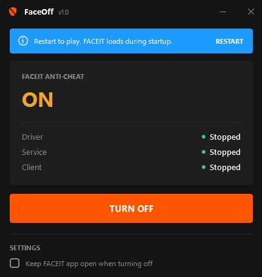

# FaceOff

Keep FACEIT's kernel anti-cheat off when you're not playing, and turn it back on before your next match.

<p align="center">
  
</p>

## Why

FACEIT installs a kernel driver (`FACEIT_AC.sys`) that loads every time Windows starts, whether you play that day or not. Kernel code has full access to your PC. FACEIT's tray icon can unload the driver, but it [comes back on the next boot](https://support.faceit.com/hc/en-us/articles/9394666828188-What-is-FACEIT-Anti-cheat-and-how-does-it-work). FaceOff keeps it off until you decide otherwise.

## Use it

1. Download `FaceOff.exe` from [Releases](../../releases). It's a single 110 KB file with nothing to install, and it runs on Windows 10 and 11.
2. Run it and allow admin access. Changing services needs it.
3. **Turn on → restart → Open anti-cheat → play → Turn off → restart.**

FACEIT only accepts a driver that loaded during startup, so both directions need a restart. FaceOff tells you when and asks before restarting.

**"Windows protected your PC"?** The exe isn't code-signed. Click **More info → Run anyway**. Releases are built by [GitHub Actions](.github/workflows/build.yml) from this repo, and each one ships with a `SHA256SUMS.txt`.

## What it changes

| | Turn off | Turn on |
|---|---|---|
| Driver `faceit` | Disabled | Loads with Windows |
| Service `FACEITService` | Disabled | Manual |
| `faceitclient.exe`, `FACEIT.exe` | Closed (tick *Keep FACEIT app open* to leave the app running) | — |

That's all. It doesn't touch FACEIT's files, makes no network connections and doesn't run at startup. FaceOff saves the original settings in `FaceOff.state` next to the exe.

## Command line

```
FaceOff.exe --status
FaceOff.exe --disable [--keep-app] [--reboot]
FaceOff.exe --enable  [--reboot]
```

Exit codes: `0` ok, `1` error, `2` restart needed.

No exe? [`scripts/faceit-off.bat`](scripts/faceit-off.bat) and [`scripts/faceit-on.bat`](scripts/faceit-on.bat) do the same thing. Run them as admin.

## Build

```
dotnet build src/FaceOff/FaceOff.csproj -c Release
```

---

Not affiliated with FACEIT. Use at your own risk. [GPL-3.0](LICENSE)
